# Cathedral Management System — Complete ERD & DFD Technical Specification

> **System**: Iglesia Filipina Independiente (IFI) — Cathedral of St. Michael the Archangel  
> **Database**: MariaDB / MySQL (38 Core Tables, 7 Functional Clusters)  
> **Purpose**: Complete Data Flow Diagram (DFD) and Entity-Relationship Diagram (ERD) Reference Guide for developers, auditors, and AI models.

---

## Table of Contents
1. [DFD Level 0: Context Diagram](#1-dfd-level-0-context-diagram)
2. [DFD Level 1: System Decomposition Diagram](#2-dfd-level-1-system-decomposition-diagram)
3. [DFD Level 2: Detailed Subsystem Workflows](#3-dfd-level-2-detailed-subsystem-workflows)
   - [3.1 Sacramental Record & Certificate Issuance](#31-sacramental-record--certificate-issuance-workflow)
   - [3.2 Event Booking & Priest Assignment](#32-event-booking--priest-assignment-workflow)
   - [3.3 Financial Donations & Store Operations](#33-financial-donations--store-operations-workflow)
4. [DFD Data Dictionary: Entities, Stores & Flows](#4-dfd-data-dictionary)
5. [Master Cross-Module ERD Architecture](#5-master-cross-module-erd-architecture)
6. [Optimized ERDs by Section Module (All 38 Tables)](#6-optimized-erds-by-section-module)
   - [Module 1: Users & Chapels (`users`, `chapels`, `my_profile`)](#module-1-users--chapels)
   - [Module 2: Services (`services`, `settings?tab=services`)](#module-2-services)
   - [Module 3: Calendar, Event Requests & Priest Duty (`events`, `event_requests`, `priest_schedule`)](#module-3-calendar-event-requests--priest-duty)
   - [Module 4: Church Records & Certificates (`records_cathedral`, `records_chapel`, `request_certificate`)](#module-4-church-records--certificates)
   - [Module 5: Giving & Store — Donations & Parish Store (`donations`, `merchandise`, `reports`)](#module-5-giving--store--donations--parish-store)
   - [Module 6: Inquiries, Tickets & Parish Chat (`public_inquiries`, `tickets`, `chat`)](#module-6-inquiries-tickets--parish-chat)
   - [Module 7: Bulletin & Parish Profile (`bulletin`, `parish_info`, `index.php`)](#module-7-bulletin--parish-profile)
   - [Module 8: Backups & Audit Logs (`audit_logs`, `backups`, `system_settings`)](#module-8-backups--audit-logs)
7. [Database Optimization & Indexing Blueprint](#7-database-optimization--indexing-blueprint)
8. [Physical Database Schema Reference (38 Tables)](#8-physical-database-schema-reference)

---

## 1. DFD Level 0: Context Diagram

The Context Diagram defines the system boundary, external actors (entities), and high-level data flows into and out of the single central process.

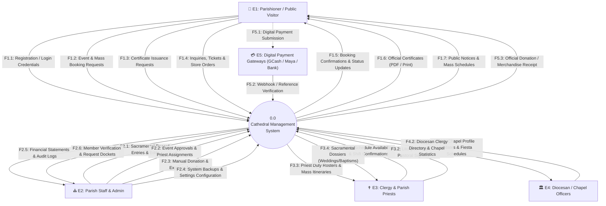

---

## 2. DFD Level 1: System Decomposition Diagram

Level 1 breaks the central system into **7 Core Processes** connected to **7 Canonical Data Stores (D1–D7)**.

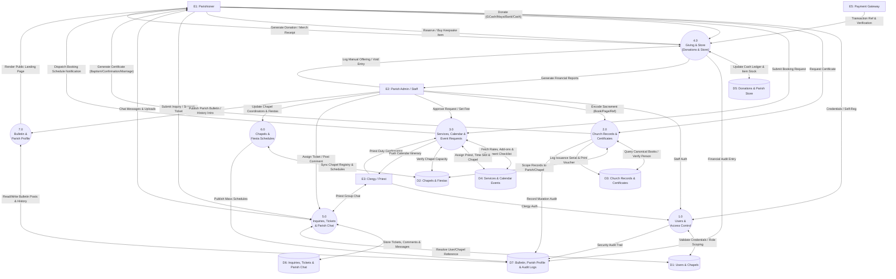

---

## 3. DFD Level 2: Detailed Subsystem Workflows

### 3.1 Sacramental Record & Certificate Issuance Workflow

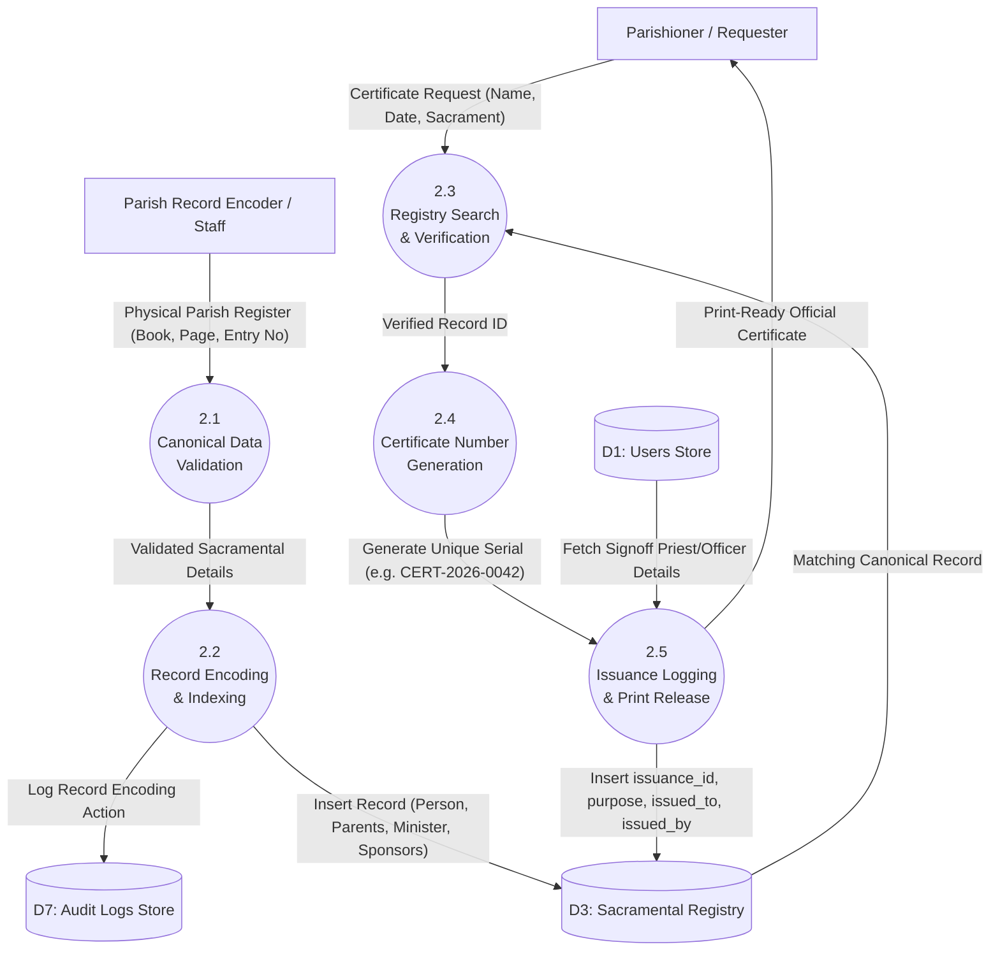

### 3.2 Event Booking & Priest Assignment Workflow

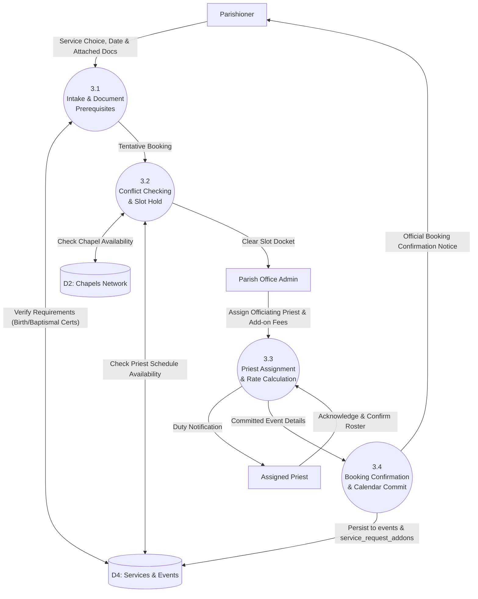

### 3.3 Financial Donations & Store Operations Workflow

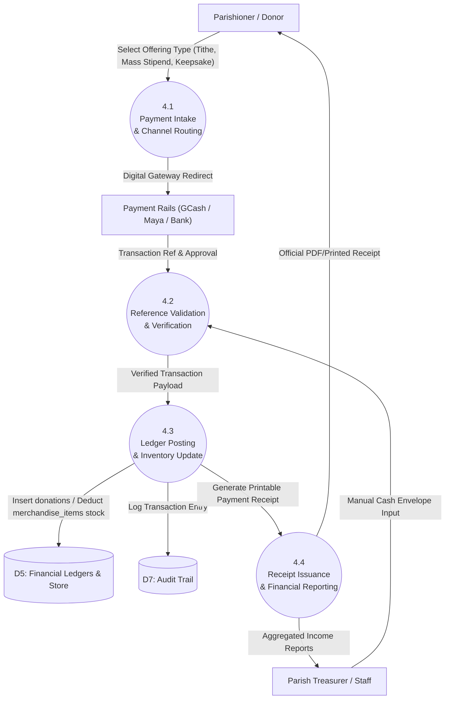

---

## 4. DFD Data Dictionary

### Data Stores (D1–D7)

| Store ID | Name | Physical Tables | Primary Purpose |
| :--- | :--- | :--- | :--- |
| **D1** | **Users & Chapels** | `users`, `system_notifications`, `notifications` | Stores credentials, user profiles, role-based authorization levels (`Admin`, `Cathedral Admin`, `Chapel Admin`, `Priest`, `Staff`, `Member`), and user/SMS alerts. |
| **D2** | **Chapels & Fiestas** | `chapels`, `chapel_fiestas` | Stores chapel directory, geographic locations, patron saints, seating capacities, and annual patronal fiesta schedules. |
| **D3** | **Church Records & Certificates** | `sacramental_records`, `certificate_types`, `certificate_issuances`, `sacramental_audit_log` | Stores church records (Baptism, Confirmation, Wedding, Funeral, Communion), register indexes, certificate issuance serials, and historical edits. |
| **D4** | **Services & Calendar Events** | `service_categories`, `services`, `service_variants`, `service_requirements`, `service_additional_charges`, `service_schedules`, `events`, `service_request_addons`, `schedules`, `mass_schedules`, `pastor_event_types` | Stores service rates, requirements, add-on charges, calendar bookings, event requests, priest duty schedules, and mass schedules. |
| **D5** | **Donations & Parish Store** | `donations`, `merchandise_items`, `merchandise_sales` | Stores donations, tithes, payment references, void tracking, and Parish Store items & sales. |
| **D6** | **Inquiries, Tickets & Parish Chat** | `public_inquiries`, `tickets`, `ticket_comments`, `parish_chat_rooms`, `parish_chat_participants`, `parish_chat_messages` | Stores public inquiries, support tickets, ticket comments, and Parish Chat rooms, participants, and messages. |
| **D7** | **Bulletin, Parish Profile & Audit Logs** | `bulletin_posts`, `parish_contact_info`, `parish_history`, `parish_history_intro`, `parish_leadership`, `parish_leadership_intro`, `audit_logs`, `backup_logs`, `system_settings` | Stores bulletin posts, Parish Profile contact info, parish history, leadership directory, audit logs, backup logs, and system settings. |

### External Entities (E1–E5)

| Entity ID | Entity Name | Description | Key Interactions |
| :--- | :--- | :--- | :--- |
| **E1** | **Parishioner / Public Visitor** | Cathedral members, visitors, and sacramental applicants. | Books services, requests certificates, donates, orders items, submits inquiries. |
| **E2** | **Parish Staff & Admin** | Cathedral office administrators, secretaries, and encoders. | Encodes registry books, manages bookings, approves members, logs finances, triggers backups. |
| **E3** | **Clergy & Parish Priests** | Cathedral Dean, parish priests, and visiting clergy. | Receives duty rosters, reviews sacramental dossiers, confirms Mass availability. |
| **E4** | **Diocesan / Chapel Officers** | Chapel coordinators, parish council heads. | Synchronizes chapel profiles, coordinates fiesta masses, reviews diocesan reports. |
| **E5** | **Payment Gateways** | External digital rails (GCash, Maya, Bank transfers). | Verifies payment references, provides settlement verification for donations and merchandise. |

---

## 5. Master Cross-Module ERD Architecture

The system database comprises **38 physical tables** organized across **8 Dashboard & Portal Section Modules**. Every tenant-scoped operational table connects back to two central anchor entities:
- **`chapels` (`chapel_id`)**: Enforces multi-chapel data isolation (`NULL` = Main Cathedral scope, `>0` = Satellite Chapel branch).
- **`users` (`id`)**: Tracks actor accountability (`requested_by`, `pastor_id`, `encoded_by`, `logged_by`, `issued_by`, `assigned_to`, `performed_by_id`).

```mermaid
flowchart TB
    subgraph M1["🏛️ Module 1: Users & Chapels"]
        CHAPELS["chapels (PK: chapel_id)"]
        FIESTAS["chapel_fiestas (PK: fiesta_id)"]
        USERS["users (PK: id)"]
        SYSNOTIF["system_notifications (PK: id)"]
        NOTIF["notifications (PK: notif_id)"]
    end

    subgraph M2["📜 Module 2: Services"]
        SRVCAT["service_categories (PK: id)"]
        SRV["services (PK: id)"]
        SRVVAR["service_variants (PK: id)"]
        SRVREQ["service_requirements (PK: id)"]
        SRVCHG["service_additional_charges (PK: id)"]
        SRVSCH["service_schedules (PK: id)"]
        CERTTYP["certificate_types (PK: id)"]
    end

    subgraph M3["📅 Module 3: Calendar, Event Requests & Priest Duty"]
        EVENTS["events (PK: event_id)"]
        ADDONS["service_request_addons (PK: id)"]
        SCHED["schedules (PK: schedule_id)"]
        PASTEV["pastor_event_types (PK: id)"]
        MASSSCH["mass_schedules (PK: schedule_id)"]
    end

    subgraph M4["🕊️ Module 4: Church Records & Certificates"]
        SACREC["sacramental_records (PK: record_id)"]
        CERTISS["certificate_issuances (PK: issuance_id)"]
        SACAUD["sacramental_audit_log (PK: audit_id)"]
    end

    subgraph M5["💰 Module 5: Giving & Store (Donations & Parish Store)"]
        DON["donations (PK: donation_id)"]
        MITEM["merchandise_items (PK: id)"]
        MSALE["merchandise_sales (PK: id)"]
    end

    subgraph M6["💬 Module 6: Inquiries, Tickets & Parish Chat"]
        INQ["public_inquiries (PK: inquiry_id)"]
        TCK["tickets (PK: ticket_id)"]
        TCKCOM["ticket_comments (PK: comment_id)"]
        CROOM["parish_chat_rooms (PK: room_id)"]
        CPART["parish_chat_participants (PK: room_id, user_id)"]
        CMSG["parish_chat_messages (PK: message_id)"]
    end

    subgraph M7["🌐 Module 7: Bulletin & Parish Profile"]
        BULL["bulletin_posts (PK: post_id)"]
        PINFO["parish_contact_info (PK: info_id)"]
        PHIST["parish_history / intro"]
        PLEAD["parish_leadership / intro"]
    end

    subgraph M8["🛡️ Module 8: Backups & Audit Logs"]
        AUDLOG["audit_logs (PK: log_id)"]
        BKLOG["backup_logs (PK: id)"]
        SYSSET["system_settings (PK: setting_key)"]
    end

    %% Core Hub Connections
    CHAPELS --> USERS
    CHAPELS --> FIESTAS
    CHAPELS --> NOTIF
    CHAPELS --> EVENTS
    CHAPELS --> SCHED
    CHAPELS --> SACREC
    CHAPELS --> DON
    CHAPELS --> INQ
    CHAPELS --> TCK
    CHAPELS --> CROOM
    CHAPELS --> BULL
    CHAPELS --> AUDLOG

    USERS --> SYSNOTIF
    USERS --> EVENTS
    USERS --> SCHED
    USERS --> PASTEV
    USERS --> MASSSCH
    USERS --> SACREC
    USERS --> CERTISS
    USERS --> SACAUD
    USERS --> DON
    USERS --> MSALE
    USERS --> TCK
    USERS --> TCKCOM
    USERS --> CROOM
    USERS --> CPART
    USERS --> CMSG
    USERS --> BULL
    USERS --> PINFO
    USERS --> PHIST
    USERS --> PLEAD
    USERS --> AUDLOG
    USERS --> BKLOG
    USERS --> SYSSET

    %% Intra-Module Flows
    SRVCAT --> SRV
    SRV --> SRVVAR
    SRV --> SRVREQ
    SRV --> SRVCHG
    SRV --> SRVSCH
    SRV --> CERTTYP
    SRV --> EVENTS
    SRVVAR --> EVENTS
    SRVCHG --> ADDONS
    EVENTS --> ADDONS
    SACREC --> CERTISS
    SACREC --> SACAUD
    MITEM --> MSALE
    MITEM --> INQ
    TCK --> TCKCOM
    CROOM --> CPART
    CROOM --> CMSG
```

---

## 6. Optimized ERDs by Section Module

> **Notation Key**:
> - `PK` = Primary Key | `FK` = Foreign Key | `UK` = Unique Key
> - Solid lines (`||--o{`, `|o--o{`) represent **Database-Enforced Foreign Key Constraints** (`56 Enforced InnoDB Foreign Keys • 0 Floating Tables` with `ON DELETE SET NULL` / `ON DELETE CASCADE` / `ON DELETE RESTRICT`).
> - Dotted lines (`|o..o{`) represent **Intentional Soft/Audit References** (`sacramental_audit_log.record_id` to preserve deleted audit history, and `parish_chat_participants.last_read_message_id` watermark).

---

### Module 1: Users & Chapels
* **Dashboard Sections**: `section=users`, `section=chapels`, `section=my_profile`, `section=settings&tab=users|chapels`
* **Controllers & Models**: `AuthController`, `AdminController`, `User`, `Chapel`, `SmsService`
* **Optimization Design**: `chapels` acts as the multi-tenant root entity. Every branch can override SMTP credentials (`smtp_host`, `from_email`) and visual branding (`theme_color`, `branch_color`). `users` stores role-scoped access (`Admin`, `Cathedral Admin`, `Chapel Admin`, `Priest`, `Pastor`, `Staff`, `Member`) plus brute-force lockout counters (`login_attempts`, `locked_until`) and priest duty windows (`duty_start_time`, `duty_end_time`).

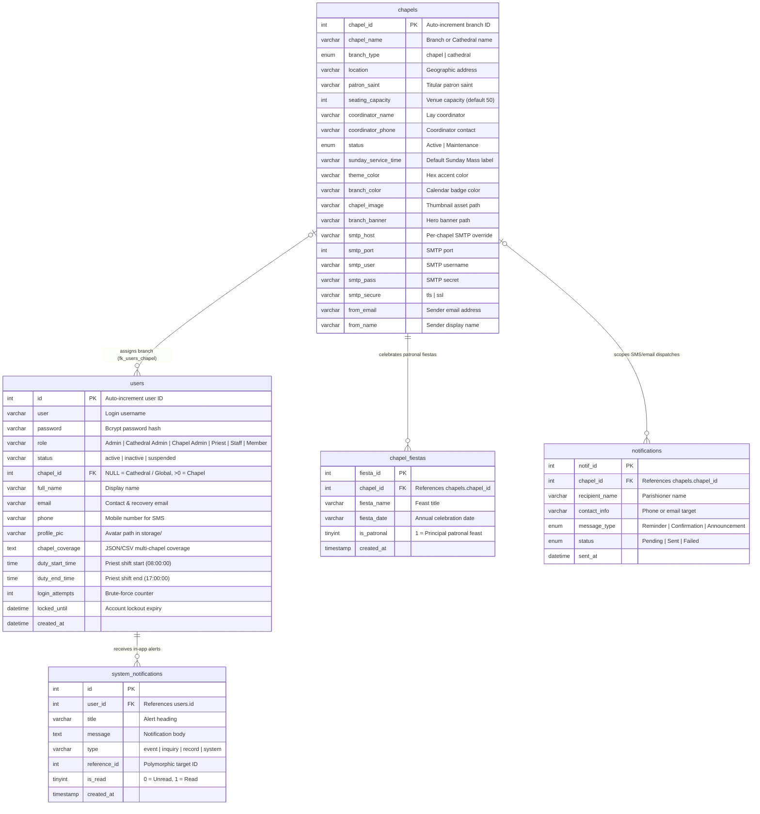

---

### Module 2: Services
* **Dashboard Sections**: `section=services`, `section=settings&tab=services`
* **Controllers & Models**: `ServiceController`, `ServiceModel`
* **Optimization Design**: Normalizes the Cathedral Synod tariff schedule (effective since the December 16, 2012 Synod) into a 3NF hierarchy: `service_categories` → `services` → (`service_variants`, `service_requirements`, `service_additional_charges`, `service_schedules`). Historical tariff versioning is supported via `effective_from`, `effective_until`, and `is_current` on `service_variants`.

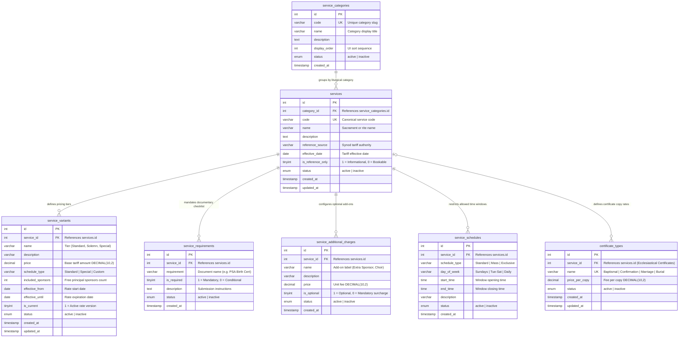

---

### Module 3: Calendar, Event Requests & Priest Duty
* **Dashboard Sections**: `section=events`, `section=overview`, `section=event_requests`, `section=request_event`, `section=priest_schedule`, `section=priest_prefs`, `section=schedule_audit`, `section=schedule_cathedral`, `section=schedule_chapel`
* **Controllers, Models & Services**: `EventController`, `Event`, `EventConflictService`, `EventAnalyticsService`
* **Optimization Design**: `events` is the operational heart of liturgical scheduling. It links catalog pricing (`service_id`, `variant_id`) and line-item extras (`service_request_addons`) with venue capacity (`chapel_id`) and clergy availability (`pastor_id`). `EventConflictService` cross-checks `events`, `schedules`, and `users` (`duty_start_time`/`duty_end_time`) to prevent double-booking and enforce a 30-minute inter-chapel travel buffer.

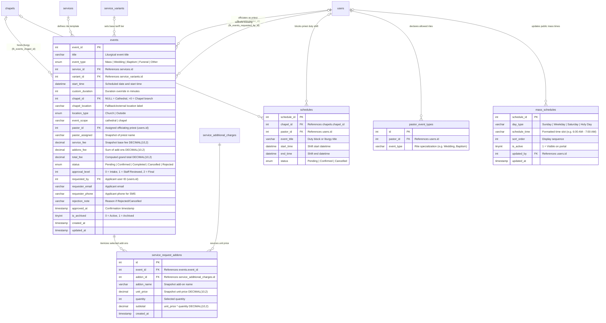

---

### Module 4: Church Records & Certificates
* **Dashboard Sections**: `section=records_cathedral`, `section=records_chapel`, `section=request_certificate`
* **Controllers, Models & Services**: `SacramentalController`, `SacramentalRecord`, `SacramentalCertificateService`, `SacramentalReportingService`
* **Optimization Design**: Uses **Single-Table Inheritance (STI)** in `sacramental_records` (`record_type` discriminator: `Baptism`, `Wedding`, `Funeral`, `Confirmation`, `Communion`) so that unified full-text searches, canonical Book/Page indexing (`book_number`, `page_number`, `reference_id`), certificate serial generation (`certificate_issuances`), and row-level JSON snapshot auditing (`sacramental_audit_log`) operate across a single indexed table without expensive multi-table `UNION` queries.

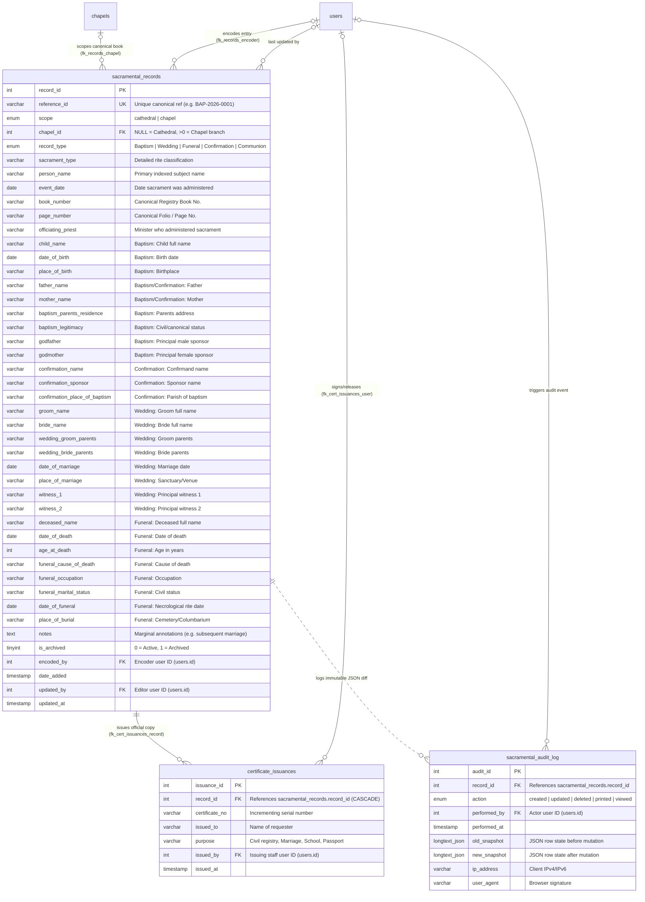

---

### Module 5: Giving & Store (Donations & Parish Store)
* **Dashboard Sections**: `section=donations`, `section=merchandise`, `section=reports`, `section=insights`
* **Controllers, Models & Views**: `FinanceController`, `Donation`, `Merchandise`, `donation_receipt.php`, `merchandise_receipt.php`, `finance_report_print.php`
* **Optimization Design**: Enforces strict financial accounting rules—`donations` never hard-deletes posted entries; instead it uses non-destructive voiding (`is_archived`, `void_reason`, `voided_by`, `voided_at`) and a `UNIQUE` index on `reference_id` (`idx_unique_ref`) to prevent duplicate receipt posting. `merchandise_items` and `merchandise_sales` power the Parish Store POS and online keepsake reservations.

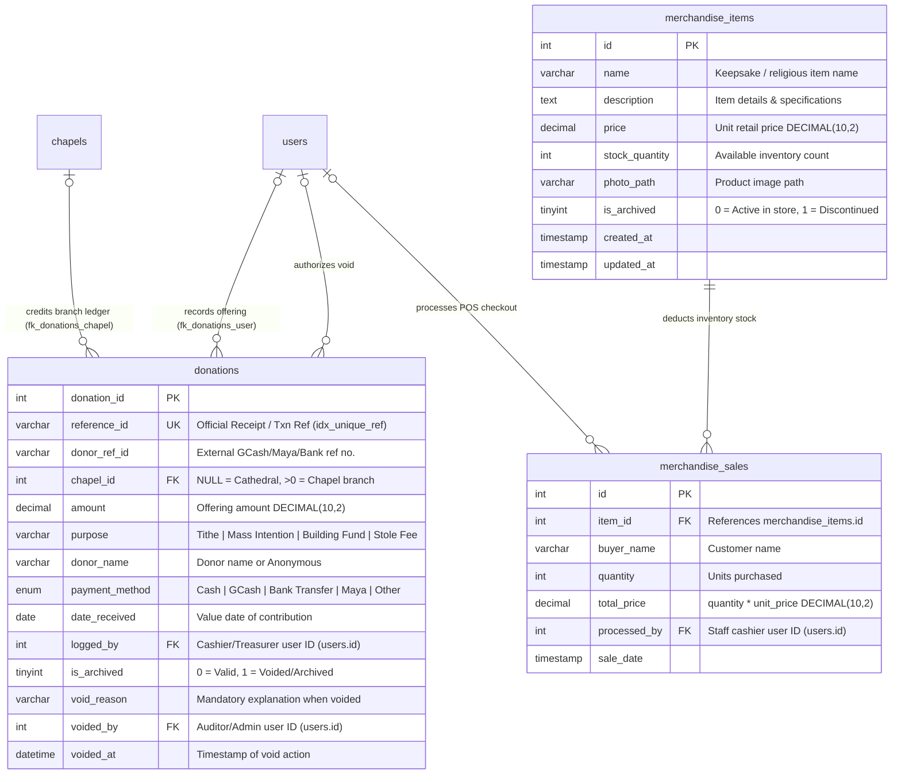

---

### Module 6: Inquiries, Tickets & Parish Chat
* **Dashboard Sections**: `section=public_inquiries`, `TicketController`, `ParishChat` widget
* **Controllers & Models**: `InquiryController`, `TicketController`, `PortalController`, `Inquiry`, `Ticket`
* **Optimization Design**: Separates external parishioner intake (`public_inquiries` for online Mass intentions, general questions, and store item reservations via `item_id`), structured issue resolution (`tickets` + `ticket_comments` with `is_internal` staff notes), and real-time internal clergy/staff messaging (`parish_chat_rooms`, composite-key `parish_chat_participants`, and `parish_chat_messages` with read-receipt watermarks `last_read_message_id`).

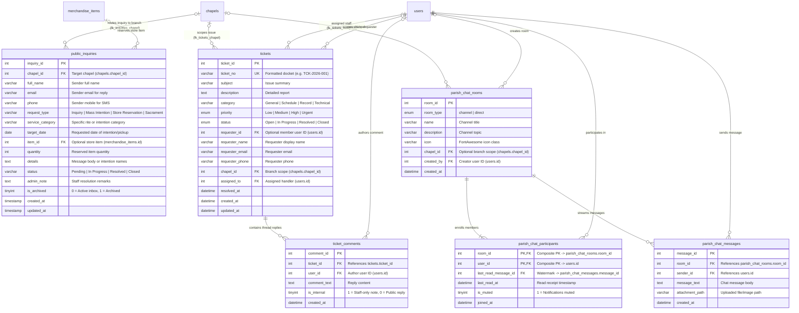

---

### Module 7: Bulletin & Parish Profile
* **Dashboard Sections**: `section=bulletin`, `section=parish_info`, `section=settings&tab=parish_info`, Public Portal (`index.php`)
* **Controllers & Models**: `DashboardController` (Bulletin actions), `AdminController`, `Bulletin`, `ParishInfo`
* **Optimization Design**: Powers the public landing page (`index.php`) and dashboard announcement board. `bulletin_posts` supports both parish-wide (`chapel_id IS NULL`) and chapel-specific notices with custom ordering (`sort_order`). Historical milestones (`parish_history` + `parish_history_intro`) and clergy/lay governance directories (`parish_leadership` + `parish_leadership_intro`) are decoupled for fast, cache-friendly reads on the public portal.

```mermaid
erDiagram
    chapels |o--o{ bulletin_posts : "scopes announcement"
    users |o--o{ bulletin_posts : "publishes notice"
    users |o--o{ parish_contact_info : "updates profile"
    users |o--o{ parish_history : "authors milestone"
    users |o--o{ parish_history_intro : "edits history intro"
    users |o--o{ parish_leadership : "manages directory"
    users |o--o{ parish_leadership_intro : "edits leadership intro"

    bulletin_posts {
        int post_id PK
        varchar title "Headline announcement"
        varchar subtitle "Supporting details"
        varchar dot_color "Hex badge color (#c9a84c)"
        int chapel_id FK "NULL = Parish-wide, >0 = Specific chapel"
        int sort_order "Manual display priority"
        tinyint is_active "1 = Published, 0 = Hidden"
        int created_by FK "Author user ID (users.id)"
        timestamp created_at
        timestamp updated_at
    }

    parish_contact_info {
        int info_id PK "Singleton row (info_id = 1)"
        varchar parish_name "Cathedral official title"
        varchar patron_saint "Cathedral titular patron"
        varchar address "Physical street address"
        varchar phone "Office telephone"
        varchar email "Official parish email"
        varchar office_hours "Operating schedule text"
        text map_embed_url "Google Maps iframe URL"
        varchar cathedral_image "Hero photo path"
        varchar coordinator_name "Cathedral office head"
        varchar coordinator_phone "Office mobile"
        varchar smtp_host "Default system SMTP host"
        int smtp_port "Default SMTP port"
        varchar smtp_user "Default SMTP user"
        varchar smtp_pass "Default SMTP password"
        varchar smtp_secure "tls | ssl"
        varchar from_email "Default sender email"
        varchar from_name "Default sender name"
        int updated_by FK "References users.id"
        timestamp updated_at
    }

    parish_history {
        int history_id PK
        varchar year "Milestone year (e.g. 1902)"
        varchar title "Historical event title"
        text description "Narrative text"
        int sort_order "Chronological display order"
        tinyint is_active "1 = Visible"
        int created_by FK "References users.id"
        timestamp created_at
        timestamp updated_at
    }

    parish_history_intro {
        int intro_id PK "Singleton intro row"
        text intro_text "Section lead paragraph"
        int updated_by FK "References users.id"
        timestamp updated_at
    }

    parish_leadership {
        int leader_id PK
        enum position_type "bishop | parish_priest | assistant | deacon | council | sectoral | executive | coordinator"
        varchar name "Clergy or officer full name"
        varchar title "Canonical or council title"
        varchar subtitle "Secondary role / assignment"
        varchar email "Contact email"
        varchar photo_path "Portrait path"
        varchar image_path "Alternate portrait path"
        int sort_order "Hierarchy display order"
        tinyint is_active "1 = Active officer"
        int created_by FK "References users.id"
        timestamp created_at
        timestamp updated_at
    }

    parish_leadership_intro {
        int intro_id PK "Singleton intro row"
        text intro_text "Leadership section lead text"
        int updated_by FK "References users.id"
        timestamp updated_at
    }
```

---

### Module 8: Backups & Audit Logs
* **Dashboard Sections**: `section=settings&tab=backups`, `section=settings&tab=reports`, `AuditLogger`, `BackupService`
* **Controllers, Models & Services**: `AdminController`, `AuditLogger`, `AuditLogSection`, `BackupService`, `tools/backup.php`, `tools/restore_web.php`
* **Optimization Design**: `audit_logs` uses `BIGINT UNSIGNED` (`log_id`) and denormalizes actor identity snapshots (`performed_by_name`, `performed_by_role`) alongside `performed_by_id` so the security ledger remains intact and human-readable even if a staff account is later deleted. `backup_logs` tracks automated and manual SQL dump snapshots, while `system_settings` provides a lightweight key-value configuration table.

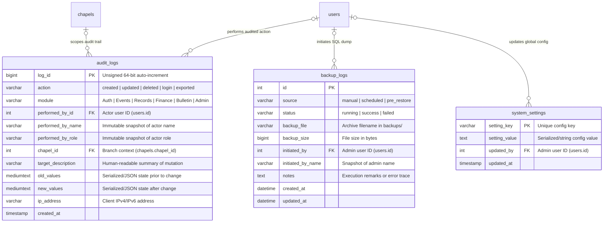

---

## 7. Database Optimization & Indexing Blueprint

To achieve peak query performance across all 8 Section Modules, the `cathedral` MySQL/MariaDB database actively enforces the following composite indexes and InnoDB Foreign Key constraints:

### 7.1 Active Composite & Unique Indexes by Module

| Section Module | Table | Active Index | Query Optimization Purpose |
| :--- | :--- | :--- | :--- |
| **M1: Users & Chapels** | `users` | `uk_users_username (user)` & `idx_users_role_status (role, status, chapel_id)` | Enforces unique usernames and accelerates Priest/Pastor roster lookups and branch-scoped staff listings. |
| **M1: Users & Chapels** | `system_notifications` | `idx_user_unread (user_id, is_read)` & `idx_created_at (created_at)` | Accelerates topbar unread notification badge queries. |
| **M2: Services** | `service_variants` | `idx_variants_service_active (service_id, status, is_current, price)` | Speeds up `ServiceModel::getFullCatalog()` join when loading active booking rates. |
| **M3: Calendar & Events** | `events` | `idx_events_cal_filter (is_archived, chapel_id, status, start_time)` | Optimizes the main dashboard Calendar (`Event::search()` and `Event::getAll()`) and status counter aggregations. |
| **M3: Calendar & Events** | `events` | `idx_events_pastor_sched (pastor_id, is_archived, status, start_time)` | Accelerates `EventConflictService` priest double-booking and travel buffer checks. |
| **M4: Church Records** | `sacramental_records` | `idx_records_composite (is_archived, scope, chapel_id, record_type, event_date)` | Powers instant filtering in `Cathedral Records` and `Chapel Records` pagination. |
| **M4: Church Records** | `sacramental_records` | `idx_records_book_page (record_type, book_number, page_number)` | Speeds up canonical registry book/page verification prior to certificate issuance. |
| **M5: Giving & Store** | `donations` | `idx_donations_ledger (is_archived, chapel_id, date_received, purpose)` | Accelerates financial summary aggregations (`FinanceController`) and date-range reports. |
| **M5: Giving & Store** | `merchandise_items` | `idx_merch_archived_name (is_archived, name)` | Speeds up active Parish Store inventory catalog queries. |
| **M6: Inquiries & Chat** | `public_inquiries` | `idx_inquiries_chapel_status (chapel_id, status, is_archived, created_at)` | Optimizes the topbar inquiries inbox and pending badge count. |
| **M7: Bulletin & Profile** | `bulletin_posts` | `idx_bulletin_active_order (is_active, chapel_id, sort_order, created_at)` | Speeds up Bulletin board and public landing page queries. |
| **M8: Backups & Audit** | `audit_logs` | `idx_module_action (module, action)` & `idx_chapel_created (chapel_id, created_at)` | Accelerates filtered audit log exports and activity timelines. |

### 7.2 Referential Integrity & Collation Standardization (Phase 2 Enforced)
All **56 Foreign Key constraints** across the 38 InnoDB tables are **actively enforced** at the database engine level (`post_phase2_optimization_20261104.sql`) with **0 floating tables**, and all 38 tables are standardized to `CHARACTER SET utf8mb4 COLLATE utf8mb4_unicode_ci`:
1. **Services Cascade**: `services.category_id -> service_categories.id (RESTRICT)`, and `ON DELETE CASCADE` from `services.id` to `service_variants`, `service_requirements`, `service_additional_charges`, `service_schedules`, and `certificate_types`.
2. **Event & Add-ons Integrity**: `events` enforces `ON DELETE SET NULL` to `chapels`, `users` (`pastor_id`, `requested_by`), `services`, and `service_variants`, while `service_request_addons` enforces `ON DELETE CASCADE` to `events`.
3. **Chat, Tickets & Notification Cascade**: `ticket_comments` cascades from `tickets`, `parish_chat_participants` and `parish_chat_messages` cascade from `parish_chat_rooms` and `users`, and `system_notifications` cascades from `users`.
4. **Immutable Audit Trail Preservation**: `sacramental_audit_log.record_id` is intentionally indexed without a cascade delete constraint so deleted sacramental records preserve their historical JSON snapshot trail (`action = 'deleted'`), while actor references (`performed_by`, `performed_by_id`, `initiated_by`, `voided_by`, `updated_by`) use `ON DELETE SET NULL`.

---

## 8. Physical Database Schema Reference (38 Tables • 56 Enforced FKs • 0 Floating Tables)

| # | Table Name | Section Module | Primary Key | Enforced Foreign Keys (56 Total) | Soft / Audit Refs | Key Indexed / Domain Columns |
| :--- | :--- | :--- | :--- | :--- | :--- | :--- |
| 1 | `chapels` | M1: Users & Chapels | `chapel_id` | — *(Parent Hub)* | — | `chapel_name`, `branch_type`, `status`, `seating_capacity` |
| 2 | `chapel_fiestas` | M1: Users & Chapels | `fiesta_id` | `chapel_id` (`CASCADE`) | — | `fiesta_name`, `fiesta_date`, `is_patronal` |
| 3 | `users` | M1: Users & Chapels | `id` | `chapel_id` (`SET NULL`) | — | `user` (UK), `role`, `status`, `duty_start_time`, `duty_end_time` |
| 4 | `system_notifications` | M1: Users & Chapels | `id` | `user_id` (`CASCADE`) | `reference_id` | `title`, `type`, `is_read`, `created_at` |
| 5 | `notifications` | M1: Users & Chapels | `notif_id` | `chapel_id` (`SET NULL`) | — | `recipient_name`, `message_type`, `status`, `sent_at` |
| 6 | `service_categories` | M2: Services | `id` | — *(Parent Hub)* | — | `code` (UK), `name`, `display_order`, `status` |
| 7 | `services` | M2: Services | `id` | `category_id` (`RESTRICT`) | — | `code` (UK), `name`, `effective_date`, `status` |
| 8 | `service_variants` | M2: Services | `id` | `service_id` (`CASCADE`) | — | `name`, `price`, `included_sponsors`, `is_current` |
| 9 | `service_requirements` | M2: Services | `id` | `service_id` (`CASCADE`) | — | `requirement`, `is_required`, `status` |
| 10 | `service_additional_charges` | M2: Services | `id` | `service_id` (`CASCADE`) | — | `name`, `price`, `is_optional`, `status` |
| 11 | `service_schedules` | M2: Services | `id` | `service_id` (`CASCADE`) | — | `schedule_type`, `day_of_week`, `start_time`, `end_time` |
| 12 | `certificate_types` | M2: Services | `id` | `service_id` (`CASCADE`) | — | `name` (UK), `price_per_copy`, `status` |
| 13 | `events` | M3: Calendar & Events | `event_id` | `chapel_id`, `pastor_id`, `requested_by`, `service_id`, `variant_id` (`SET NULL`) | — | `title`, `event_type`, `start_time`, `total_fee`, `status`, `approval_level` |
| 14 | `service_request_addons` | M3: Calendar & Events | `id` | `event_id` (`CASCADE`), `addon_id` (`RESTRICT`) | — | `addon_name`, `unit_price`, `quantity`, `subtotal` |
| 15 | `schedules` | M3: Calendar & Events | `schedule_id` | `chapel_id`, `pastor_id` (`SET NULL`) | — | `event_title`, `start_time`, `end_time`, `status` |
| 16 | `pastor_event_types` | M3: Calendar & Events | `id` | `pastor_id` (`CASCADE`) | — | `event_type` |
| 17 | `mass_schedules` | M3: Calendar & Events | `schedule_id` | `updated_by` (`SET NULL`) | — | `day_type`, `schedule_time`, `sort_order`, `is_active` |
| 18 | `sacramental_records` | M4: Church Records | `record_id` | `chapel_id`, `encoded_by`, `updated_by` (`SET NULL`) | — | `reference_id` (UK), `scope`, `record_type`, `person_name`, `event_date`, `book_number`, `page_number` |
| 19 | `certificate_issuances` | M4: Church Records | `issuance_id` | `record_id` (`CASCADE`), `issued_by` (`SET NULL`) | — | `certificate_no`, `issued_to`, `purpose`, `issued_at` |
| 20 | `sacramental_audit_log` | M4: Church Records | `audit_id` | `performed_by` (`SET NULL`) | `record_id` (Audit) | `action`, `old_snapshot` (JSON), `new_snapshot` (JSON) |
| 21 | `donations` | M5: Giving & Store | `donation_id` | `chapel_id`, `logged_by`, `voided_by` (`SET NULL`) | — | `reference_id` (UK), `amount`, `purpose`, `payment_method`, `date_received`, `is_archived` |
| 22 | `merchandise_items` | M5: Giving & Store | `id` | — *(Parent Hub)* | — | `name`, `price`, `stock_quantity`, `is_archived` |
| 23 | `merchandise_sales` | M5: Giving & Store | `id` | `item_id` (`RESTRICT`), `processed_by` (`SET NULL`) | — | `buyer_name`, `quantity`, `total_price`, `sale_date` |
| 24 | `public_inquiries` | M6: Inquiries & Chat | `inquiry_id` | `chapel_id`, `item_id` (`SET NULL`) | — | `full_name`, `request_type`, `status`, `is_archived` |
| 25 | `tickets` | M6: Inquiries & Chat | `ticket_id` | `chapel_id`, `assigned_to`, `requester_id` (`SET NULL`) | — | `ticket_no` (UK), `subject`, `priority`, `status` |
| 26 | `ticket_comments` | M6: Inquiries & Chat | `comment_id` | `ticket_id` (`CASCADE`), `user_id` (`SET NULL`) | — | `comment_text`, `is_internal`, `created_at` |
| 27 | `parish_chat_rooms` | M6: Inquiries & Chat | `room_id` | `chapel_id`, `created_by` (`SET NULL`) | — | `room_type`, `name`, `created_at` |
| 28 | `parish_chat_participants` | M6: Inquiries & Chat | `room_id`, `user_id` | `room_id`, `user_id` (`CASCADE`) | `last_read_message_id` | `last_read_at`, `is_muted`, `joined_at` |
| 29 | `parish_chat_messages` | M6: Inquiries & Chat | `message_id` | `room_id`, `sender_id` (`CASCADE`) | — | `message_text`, `attachment_path`, `created_at` |
| 30 | `bulletin_posts` | M7: Bulletin & Profile | `post_id` | `chapel_id`, `created_by` (`SET NULL`) | — | `title`, `dot_color`, `sort_order`, `is_active` |
| 31 | `parish_contact_info` | M7: Bulletin & Profile | `info_id` | `updated_by` (`SET NULL`) | — | `parish_name`, `patron_saint`, `address`, `phone`, `email` |
| 32 | `parish_history` | M7: Bulletin & Profile | `history_id` | `created_by` (`SET NULL`) | — | `year`, `title`, `sort_order`, `is_active` |
| 33 | `parish_history_intro` | M7: Bulletin & Profile | `intro_id` | `updated_by` (`SET NULL`) | — | `intro_text` |
| 34 | `parish_leadership` | M7: Bulletin & Profile | `leader_id` | `created_by` (`SET NULL`) | — | `position_type`, `name`, `title`, `sort_order`, `is_active` |
| 35 | `parish_leadership_intro` | M7: Bulletin & Profile | `intro_id` | `updated_by` (`SET NULL`) | — | `intro_text` |
| 36 | `audit_logs` | M8: Backups & Audit | `log_id` | `performed_by_id`, `chapel_id` (`SET NULL`) | — | `action`, `module`, `old_values`, `new_values`, `ip_address` |
| 37 | `backup_logs` | M8: Backups & Audit | `id` | `initiated_by` (`SET NULL`) | — | `source`, `status`, `backup_file`, `backup_size` |
| 38 | `system_settings` | M8: Backups & Audit | `setting_key` | `updated_by` (`SET NULL`) | — | `setting_value`, `updated_at` |

