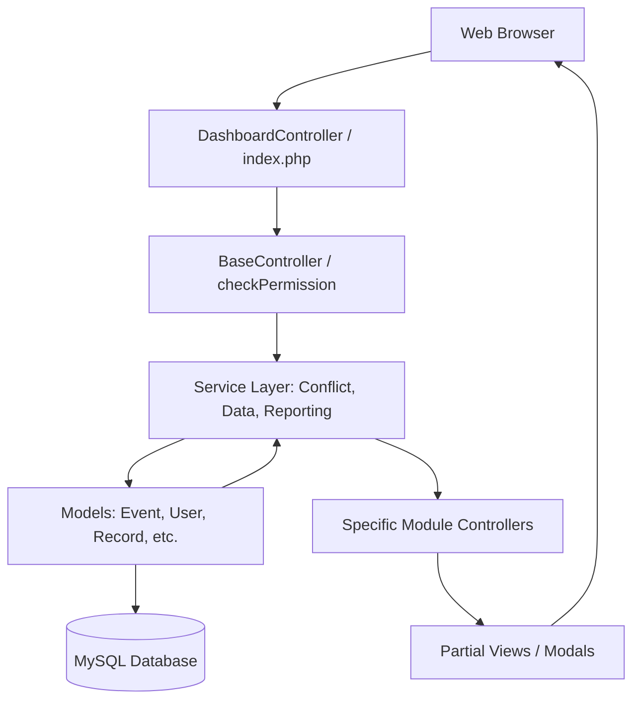
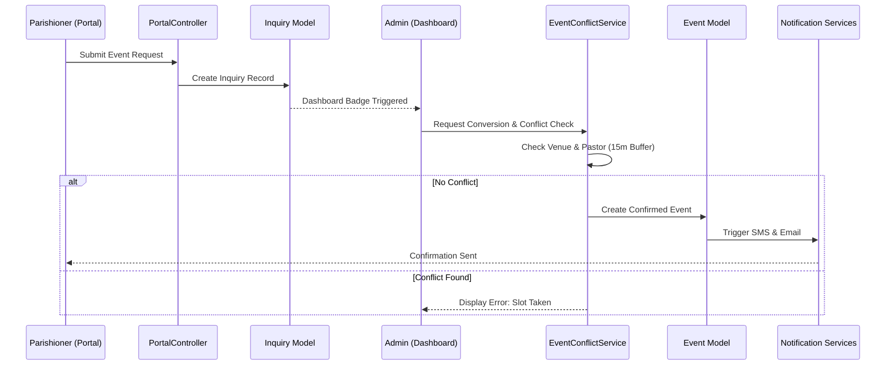
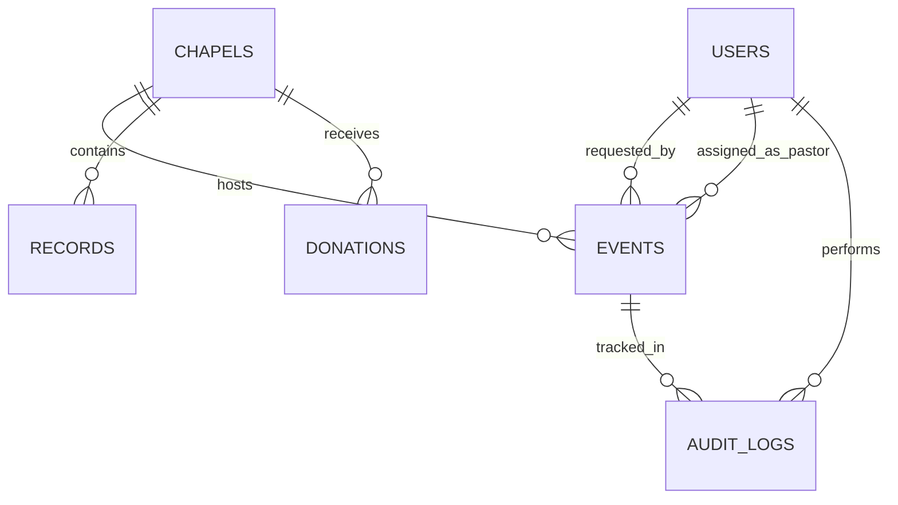
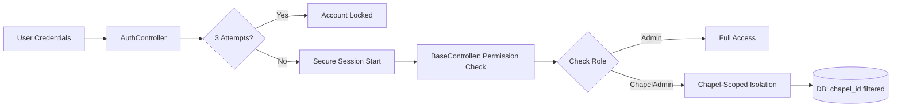

# Cathedral Management System (CMS): Comprehensive Technical Blueprint

## 1. System Architecture Overview
The CMS is architected as a **Modular MVC (Model-View-Controller)** application, optimized for high performance and strict data isolation. It utilizes a centralized entry-point pattern for administrative tasks, while maintaining a decoupled public-facing portal.

### 1.1 Architectural Visualization


---

## 2. Module & Subsystem Breakdown
The system is divided into eight primary subsystems, each with a dedicated controller, model, and set of views.

| Subsystem | Responsibilities | Key Components |
| :--- | :--- | :--- |
| **Authentication** | Session hardening, CSRF protection, RBAC enforcement. | `AuthController`, `User.php`, `BaseController.php`. |
| **Pastoral/Events** | Multi-venue scheduling, pastor assignment, conflict resolution. | `EventController`, `EventConflictService`, `Event.php`. |
| **Sacramental** | Canonical record management (Baptisms, Weddings, etc.). | `SacramentalController`, `SacramentalRecord.php`. |
| **Finance** | Multi-branch donation ledgering, merchandise tracking. | `FinanceController`, `Donation.php`, `Merchandise.php`. |
| **Inquiries** | Public-to-Admin request conversion and message tracking. | `InquiryController`, `PortalController`, `Inquiry.php`. |
| **Support Tickets** | Internal issue tracking and operational commentary. | `TicketController`, `Ticket.php`. |
| **Parish Config** | Branding, leadership profiles, and global settings. | `AdminController`, `ParishInfo.php`, `Chapel.php`. |
| **Notifications** | Automated SMS/Email dispatching and dashboard badges. | `SmsService`, `EventRequestMailer`, `notifications.php`. |

---

## 3. Component Purpose & Responsibilities
*   **Controllers**: Orchestrate requests. They do not contain business logic; instead, they call services and models.
*   **Services**: The "Brains" of the system. They handle cross-model calculations (e.g., checking if a pastor is free across three different chapels).
*   **Models**: The "Data Keepers". They handle raw SQL execution, sanitization, and data retrieval.
*   **Views**: The "Face". They use a partial inclusion pattern to load sections asynchronously, reducing initial page load time.

---

## 4. Logic Flows & Interactions

### 4.1 Process: Public Request to Confirmed Event


1.  **Entry**: User submits a form on `public_requests.php`.
2.  **Processing**: `PortalController` validates input and creates a `public_inquiries` record.
3.  **Discovery**: Admin receives a dashboard notification badge via `notifications.php`.
4.  **Review**: Admin reviews the inquiry in `InquiryController`.
5.  **Validation**: Admin clicks "Convert to Event". The system calls `EventConflictService::checkConflict()`.
    *   *Check 1*: Is the venue (Chapel) booked?
    *   *Check 2*: Is the assigned Pastor already busy?
    *   *Check 3*: Is there a 15-minute "buffer" between the new and existing events?
6.  **Persistence**: If clear, `Event.php` creates the record.
7.  **Automation**: `EventRequestMailer` sends an approval email; `SmsService` sends a text confirmation.

---

## 5. Business Logic & System Behavior
*   **Conflict Detection**: Enforces a strict 15-minute gap for logistics.
*   **Financial Voiding**: Non-destructive. A `void_reason` is required, and the record is moved to an archive state but remains visible in audit logs.
*   **Certificate Tracking**: Every sacramental certificate printed increments an issuance counter and logs the `issued_to` and `purpose` for canonical security.

---

## 6. Database Relationships & Data Handling
### 6.1 Schema Relationships


*   **Chapels <-> Records**: All financial, sacramental, and event records are linked to a `chapel_id`.
*   **Users <-> Roles**: Roles are mapped to binary capabilities (e.g., `is_admin`, `is_pastor`).
*   **Audit Logs**: Every state-changing query (INSERT/UPDATE/DELETE) triggers an `AuditLogger` entry.

### 6.2 Data Handling
*   **Sanitization**: All input passes through `mysqli_real_escape_string` or prepared statement binding.
*   **Pagination**: Standard 30-record limit enforced across all administrative tables to maintain performance.

---

## 7. Authentication & Security Flow


1.  **Login**: `AuthController` validates credentials and checks for account locking (3 failed attempts).
2.  **Session**: A secure, `HttpOnly` session is created.
3.  **Gatekeeping**: Every request is intercepted by `BaseController::checkPermission()`.
4.  **Isolation**: For Chapel Admins, the system injects `WHERE chapel_id = ?` into every query, making it impossible to "leak" data from other branches.

---

## 8. State Management & Data Sync
*   **AJAX sections**: The dashboard does not refresh the whole page. It uses `ajax_renderer.php` to fetch only the required HTML partial.
*   **Field Syncing**: The `events` table stores cached strings for `pastor_assigned` and `chapel_location`. This prevents expensive JOINs during high-traffic calendar views.

---

## 9. Error Handling & Fallbacks
*   **Database**: Uses `try-catch` blocks in Service layers to rollback transactions if any part of a multi-table update fails.
*   **Validation**: CSRF tokens are validated for every POST request.
*   **SMS Fallback**: If the Semaphore API is unavailable, the `SmsService` logs the message to `storage/logs/sms_fail.log` so admins can manually follow up.
*   **Email Fallback**: Each chapel can define its own SMTP settings. If a chapel's SMTP fails, the system defaults to the main Cathedral SMTP.

---

## 10. File Structure & Organization
```text
/app
  /controllers  - Request orchestration & Auth
  /models       - DB queries & logic
  /services     - Complex business rules (Conflicts, Analytics)
  /mail         - Templated email logic
/views
  /pages        - Full page layouts
  /partials     - Modular UI components (Dashboard, Modals)
/assets
  /css          - Modular styles (layout, components, dashboard)
  /js           - Core dashboard and calendar logic
/storage        - Logs, Backups, and Uploads
```

---

## 11. Recommendations for Scalability
1.  **Queue Implementation**: Move high-latency tasks (SMS/Email) to a background queue.
2.  **Schema Normalization**: Convert `event_type` to a lookup table to support dynamic event categories.
3.  **Asset Minification**: Implement a build step for CSS/JS to improve mobile loading times.
